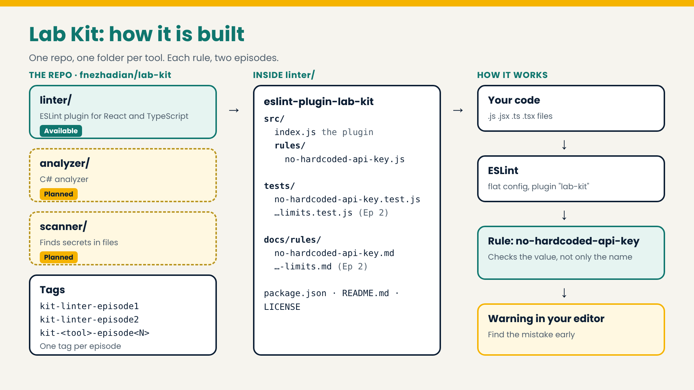

# Lab Kit

A free box of small security tools by [Flor's Lab](https://www.youtube.com/@flordevlab). Built-in security: find the mistake early, inside your editor and your build.

Each rule comes in two episodes: one to meet it, one to challenge it. Every episode is one tag in this repository.

## How it is built

## Tools

| Tool | Folder | Status |
| --- | --- | --- |
| Linter (React and TypeScript) | [`linter/`](linter/) | Available: `eslint-plugin-lab-kit` |
| Analyzer (C#) | `analyzer/` | Planned |
| Scanner (finds secrets) | `scanner/` | Planned |

## Episodes

Tags use the pattern `kit-<tool>-episode<N>`.

| Tag | Episode |
| --- | --- |
| `kit-linter-episode1` | Hardcoded API keys: meet the rule |
| `kit-linter-episode2` | Hardcoded API keys: challenge the rule (coming next) |

## License

[MIT](LICENSE)
