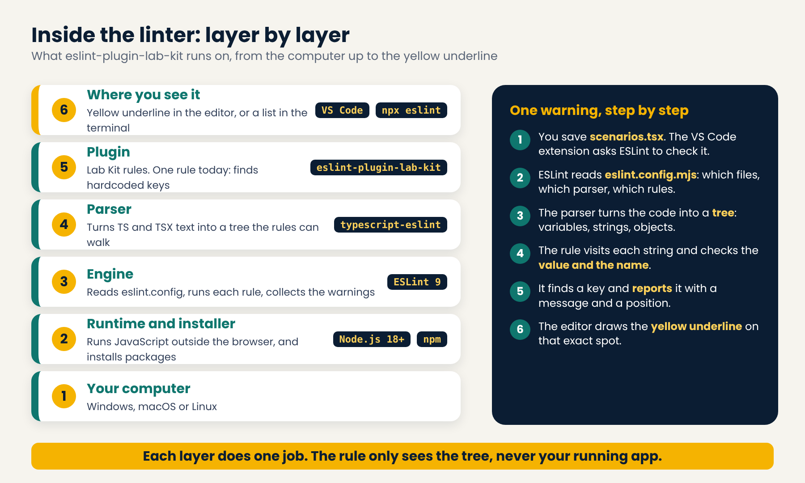

# eslint-plugin-lab-kit

ESLint rules that find security mistakes in your code, right inside your editor.

Part of **Lab Kit** by Flor's Lab: a free box of small security tools. This is the first tool: the linter, for React and TypeScript.

## Installation

```bash
npm install --save-dev eslint eslint-plugin-lab-kit
```

Requires ESLint 9 or newer (flat config).

The plugin lives in the `linter/` folder of the [Lab Kit repository](https://github.com/fnezhadian/lab-kit).

## Usage

In `eslint.config.js` (flat config):

```js
import labKit from "eslint-plugin-lab-kit";

export default [
  {
    files: ["**/*.{js,jsx}"],
    languageOptions: {
      ecmaVersion: 2022,
      sourceType: "module",
      parserOptions: { ecmaFeatures: { jsx: true } }
    },
    plugins: { "lab-kit": labKit },
    rules: {
      "lab-kit/no-hardcoded-api-key": "warn"
    }
  }
];
```

For TypeScript and TSX files, add the TypeScript parser (`npm install --save-dev typescript-eslint`):

```js
import tseslint from "typescript-eslint";
import labKit from "eslint-plugin-lab-kit";

export default [
  {
    files: ["**/*.{ts,tsx}"],
    languageOptions: {
      parser: tseslint.parser,
      parserOptions: { ecmaFeatures: { jsx: true } }
    },
    plugins: { "lab-kit": labKit },
    rules: {
      "lab-kit/no-hardcoded-api-key": "warn"
    }
  }
];
```

## How it is built



The rule never runs your app. It reads your code as text, turns it into a tree, and looks at every string in that tree.

## What you need

| You need | Why |
| --- | --- |
| [Node.js](https://nodejs.org) 18 or newer (the LTS version) | Runs ESLint, and the VS Code extension needs it too |
| [VS Code](https://code.visualstudio.com) with the **ESLint** extension (by Microsoft) | Shows the yellow underlines |
| ESLint 9 or newer | The engine that runs the rules |
| `typescript-eslint` | Lets ESLint read `.ts` and `.tsx` files |

Just watching the videos? You need nothing.

## Try it yourself

1. Install Node.js (LTS) from nodejs.org. Close and reopen your terminal, then check it:

   ```bash
   node -v
   ```

2. Install the ESLint extension in VS Code (search for "ESLint", publisher Microsoft).
3. Make a new folder and install the packages:

   ```bash
   mkdir lab-kit-demo
   cd lab-kit-demo
   npm init -y
   npm install -D eslint typescript-eslint eslint-plugin-lab-kit
   ```

4. Create `eslint.config.mjs` with the TypeScript config shown under **Usage** above (use `import` and `export default`).
5. Create `demo.tsx` with one fake secret:

   ```tsx
   const apiKey = "AbCd1234EfGh5678IjKl9012MnOp3456";
   ```

6. Run it in the terminal:

   ```bash
   npx eslint demo.tsx
   ```

   You should see one warning from `lab-kit/no-hardcoded-api-key`.
7. Open the folder in VS Code and open `demo.tsx`. The line gets a yellow underline.

**No underline in VS Code?** Press Ctrl+Shift+P and run `ESLint: Restart ESLint Server`. If it still fails, open View > Output, pick **ESLint**, and read the last lines. The most common cause is Node.js missing from your PATH: `node -v` must work in a new terminal.

## Rules

| Rule | What it does | Docs |
| --- | --- | --- |
| `no-hardcoded-api-key` | Finds hardcoded API keys and secrets. Checks the value, not only the name. | [docs](docs/rules/no-hardcoded-api-key.md), [what it can not catch](docs/rules/no-hardcoded-api-key-limits.md) |

## Philosophy

Security should be built **from the inside out**, not only with outside layers. A rule in your editor finds the mistake early. It is one layer, not the only one: see the known limits of each rule in its docs.

## Episodes

Every rule comes in two episodes on the Flor's Lab channel: one to meet the rule, one to challenge it. Each episode is one tag in this repository.

| Tag | Episode |
| --- | --- |
| `kit-linter-episode1` | Hardcoded API keys: meet the rule |
| `kit-linter-episode2` | Hardcoded API keys: challenge the rule |

## License

[MIT](LICENSE)
